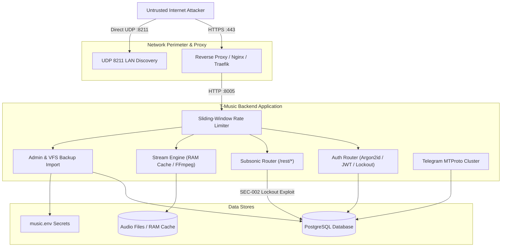

# T-Music: Comprehensive Production Security Audit Report
**Classification:** T-Music Application Security Assessment  
**Standard:** OWASP Top 10:2025 · OWASP ASVS 5.0 (L2/L3) · OWASP API Security Top 10:2023 · NIST SP 800-53 / 800-115  
**Audit Date:** 2026-10-19  
**Auditor:** Principal Application Security Engineer & DevSecOps Specialist  
**Target Repository:** `K:\test\tmusic` (Branch: `fix/long-m4a-transcode-playback` @ `1a41ea0`)  
**Release Gate Decision:** **BLOCKED (DO NOT DEPLOY TO PUBLIC INTERNET UNTIL P0 REMEDIATIONS ARE APPLIED)**

---

## 1. Executive Summary & Verdict

T-Music has undergone an exhaustive, evidence-based security audit prior to planned public internet exposure. The audit evaluated the full application stack: FastAPI backend, React 19 SPA, PostgreSQL storage engine, Telegram MTProto cluster, audio streaming and transcoding pipeline, Subsonic API, Android Capacitor mobile client, and Docker containerization.

### Release Gate Status: **BLOCKED**

Public internet deployment is currently **BLOCKED** by two critical vulnerabilities:
1. **[CRITICAL / CWE-259] Hardcoded Default Admin Password (`SEC-001`):** In accordance with the owner's 2026-10-02 decision for private LAN usage, the administrator password hash corresponds to `123`. Exposing this endpoint to the public internet allows trivial automated credential stuffing, granting full administrative control over the VFS file system, SQL backup import, user tokens, and background Telegram cluster operations.
2. **[HIGH / CWE-307 / CWE-400] Anonymous Denial of Service via Subsonic API Account Lockout (`SEC-002`):** Failed Subsonic authentication requests via `/rest/*` mutate `app_users.failed_login_attempts`. Because `/rest/*` does not enforce IP-level lockout and permits 600 requests/minute, any anonymous attacker sending 5 failed authentication requests with username `admin` triggers a 15-minute complete account lockout across both Subsonic and the web admin UI. This attack can be maintained indefinitely.

Secondary high and medium findings (`SEC-003` to `SEC-008`) must be addressed in pre-production staging.

---

## 2. Scope & Target Inventory

### 2.1 Codebase & Environment Inventory
- **Repository Root:** `K:\test\tmusic`
- **Backend:** Python 3.13.14, FastAPI 0.115.8, Starlette 0.45.3, Uvicorn 0.34.0, SQLAlchemy 2.0.38, Pydantic 2.10.6, PyJWT 2.10.1, Argon2-cffi 23.1.0, Cryptography 44.0.1.
- **Frontend:** React 19.0.0, Vite 6.1.0, Zustand 5.0.3, Lucide React 1.16.0.
- **Mobile:** Capacitor 7.0.1, Android 14+ Target SDK.
- **Database:** PostgreSQL 15+ (tested on PostgreSQL 18.0).
- **Audio Processing:** FFmpeg 7.1 (external / containerized), Mutagen 1.47.0.
- **External Interfaces:** Telegram MTProto via Pyrofork / TgCrypto; Last.fm API; Subsonic API v1.16.1; UDP LAN Discovery (Port 8211).

### 2.2 Attack Surface & Route Mapping
Static inspection verified **122 distinct HTTP routes** across 15 routers:
- Authentication & Sessions: [`backend/app/api/auth_router.py`](file:///K:/test/tmusic/backend/app/api/auth_router.py) (9 routes)
- Admin Management: [`backend/app/api/admin_router.py`](file:///K:/test/tmusic/backend/app/api/admin_router.py), [`admin_vfs_router.py`](file:///K:/test/tmusic/backend/app/api/admin_vfs_router.py), [`admin_tg_router.py`](file:///K:/test/tmusic/backend/app/api/admin_tg_router.py) (28 routes)
- Music Streaming & Caching: [`backend/app/api/stream_router.py`](file:///K:/test/tmusic/backend/app/api/stream_router.py) (4 routes)
- Library, Albums, Artists, Tracks, Playlists: [`backend/app/api/library_router.py`](file:///K:/test/tmusic/backend/app/api/library_router.py), [`tracks_router.py`](file:///K:/test/tmusic/backend/app/api/tracks_router.py), [`albums_router.py`](file:///K:/test/tmusic/backend/app/api/albums_router.py), [`artists_router.py`](file:///K:/test/tmusic/backend/app/api/artists_router.py), [`playlists_router.py`](file:///K:/test/tmusic/backend/app/api/playlists_router.py) (41 routes)
- Subsonic REST API: [`backend/app/api/subsonic_router.py`](file:///K:/test/tmusic/backend/app/api/subsonic_router.py) (22 routes)
- Shared Links & Guest Access: [`backend/app/api/share_router.py`](file:///K:/test/tmusic/backend/app/api/share_router.py) (6 routes)
- Analytics, Radio, Lyrics, System: [`backend/app/api/analytics_router.py`](file:///K:/test/tmusic/backend/app/api/analytics_router.py), [`radio_router.py`](file:///K:/test/tmusic/backend/app/api/radio_router.py), [`lyrics_router.py`](file:///K:/test/tmusic/backend/app/api/lyrics_router.py), [`system_router.py`](file:///K:/test/tmusic/backend/app/api/system_router.py) (12 routes)
- Static & SPA Mounts: Non-OpenAPI fallback `/{full_path:path}` and `/assets/*`.

---

## 3. Threat Model & Attacker Profile



### Evaluated Threat Scenarios:
1. **Unauthenticated Public Attacker:** Exploits default credentials, SSRF in cover art proxy, buffer/memory exhaustion in audio streaming, or account lockout in public endpoints.
2. **Authenticated Low-Privilege User (`user` role):** Attempts IDOR on private playlists, privilege escalation to `editor` or `admin`, or arbitrary file write via profile avatar uploads.
3. **Compromised Mobile Client:** Interception of cleartext traffic over untrusted Wi-Fi networks, malicious WebView navigation, and credential leakage.
4. **Network Scanner / Malicious Peer:** UDP packet flooding to port 8211 for topology enumeration and amplification.

---

## 4. Detailed Audit Findings Matrix

| Finding ID | Title | Severity | CWE | OWASP Top 10 | Target Location | Release Blocker? |
|---|---|---|---|---|---|---|
| **SEC-001** | Default / Weak Admin Credentials (`123`) in Public Threat Model | **CRITICAL** | CWE-259, CWE-521 | A07:2025 | [`backend/app/services/bootstrap.py:44`](file:///K:/test/tmusic/backend/app/services/bootstrap.py#L44-L78), `music.env` | **YES** |
| **SEC-002** | Unauthenticated Account Lockout DoS via Subsonic API | **HIGH** | CWE-307, CWE-400 | A04:2025 | [`backend/app/services/subsonic_auth.py:127`](file:///K:/test/tmusic/backend/app/services/subsonic_auth.py#L127-L142) | **YES** |
| **SEC-003** | Historical Database Credentials in Git Commit History | **HIGH** | CWE-798, CWE-522 | A01:2025 | Git commit `d09674c839b636e1a3a069fdde6119cfb101b878` | **NO (Remediate)** |
| **SEC-004** | Insecure Cleartext Traffic & Permissive Navigation in Mobile App | **HIGH** | CWE-319, CWE-942 | A02:2025 | [`mobile/capacitor.config.ts:16`](file:///K:/test/tmusic/mobile/capacitor.config.ts#L16-L19), [`AndroidManifest.xml:13`](file:///K:/test/tmusic/mobile/android/app/src/main/AndroidManifest.xml#L13) | **NO (Remediate)** |
| **SEC-005** | Public Exposure of UDP LAN Discovery Port 8211 | **MEDIUM** | CWE-200, CWE-406 | A05:2025 | [`docker-compose.yml:35`](file:///K:/test/tmusic/docker-compose.yml#L35), [`discovery_service.py:57`](file:///K:/test/tmusic/backend/app/services/discovery_service.py#L57-L75) | **NO (Remediate)** |
| **SEC-006** | Insecure Default Cookie Flags (`COOKIE_SECURE=false`) & Missing HSTS | **MEDIUM** | CWE-614, CWE-319 | A05:2025 | `music.env`, [`backend/app/api/auth_router.py:48`](file:///K:/test/tmusic/backend/app/api/auth_router.py#L48-L56), [`main.py:299`](file:///K:/test/tmusic/backend/app/main.py#L299-L301) | **NO (Remediate)** |
| **SEC-007** | Reverse Proxy IP Spoofing and Shared IP Lockout Risk | **MEDIUM** | CWE-290, CWE-307 | A05:2025 | `music.env:TRUST_PROXY_HEADERS`, [`backend/app/main.py:65`](file:///K:/test/tmusic/backend/app/main.py#L65) | **NO (Remediate)** |
| **SEC-008** | Catastrophic ReDoS in Frontend Build Dependency (`source-map-js`) | **LOW** | CWE-1333 | A06:2025 | `package-lock.json` (`source-map-js@1.0.2`) | **NO (Remediate)** |

---

## 5. In-Depth Technical Vulnerability Analysis

### SEC-001: Default / Weak Admin Credentials in Public Threat Model
- **Vulnerability Type:** CWE-259 (Hard-coded Password), CWE-521 (Weak Password Requirements)
- **CVSS v3.1 Score:** 9.8 (Critical) `CVSS:3.1/AV:N/AC:L/PR:N/UI:N/S:U/C:H/I:H/A:H`
- **Component:** [`backend/app/services/bootstrap.py`](file:///K:/test/tmusic/backend/app/services/bootstrap.py#L44-L78), [`music.env`](file:///K:/test/tmusic/music.env)
- **Description:**
  Per the repository documentation ([`obsidian/04-Безопасность/Пароль администратора.md`](file:///K:/test/tmusic/obsidian/04-Безопасность/Пароль%20администратора.md)), the owner mandated on 2026-10-02 that the admin panel password is fixed to `123`. The hash in `music.env` (`ADMIN_PASSWORD_HASH`) is seeded into the live database on startup. Automated test suites enforce this constraint with `protect_admin_password` and fail if modified.
- **Proof of Concept / Impact:**
  On a publicly reachable IP address, automated port scanners and brute-force bots will test standard dictionary credentials (`admin:123`, `admin:admin`). The sliding window limiter allows 10 attempts/minute per IP, and the account lockout is 5 attempts. A dictionary attack testing `123` succeeds on attempt 1.
  Upon gaining admin access, the attacker possesses:
  1. `POST /api/admin/vfs/import-sql`: Direct file uploads to import SQL dumps.
  2. `POST /api/admin/db/vacuum` & `reindex`: Database operations.
  3. `GET /api/admin/backups`: Ability to list and download system backups.
  4. `POST /api/admin/users`: Creation of rogue administrator accounts.
- **Required Remediation:**
  1. Do NOT expose port 8005 or the admin panel directly to the open internet without an upstream barrier.
  2. For production internet deployment, rotate `ADMIN_PASSWORD_HASH` to a strong random passphrase (minimum 16 alphanumeric + symbol characters) generated via `python scripts/init_admin.py`.
  3. Alternatively, implement upstream reverse proxy routing that restricts `/api/auth/login` and `/api/admin/*` to a trusted corporate VPN, Tailscale IP range, or mutual TLS (mTLS).

---

### SEC-002: Unauthenticated Account Lockout DoS via Subsonic API
- **Vulnerability Type:** CWE-307 (Improper Restriction of Excessive Authentication Attempts), CWE-400 (Uncontrolled Resource Consumption)
- **CVSS v3.1 Score:** 7.5 (High) `CVSS:3.1/AV:N/AC:L/PR:N/UI:N/S:U/C:N/I:N/A:H`
- **Component:** [`backend/app/services/subsonic_auth.py`](file:///K:/test/tmusic/backend/app/services/subsonic_auth.py#L127-L142), [`backend/app/services/auth_service.py`](file:///K:/test/tmusic/backend/app/services/auth_service.py#L182-L188)
- **Description:**
  The Subsonic endpoint `/rest/*` allows clients to authenticate using query parameters (`u=username`, `p=token` or `t=token_hash`, `s=salt`).
  When credentials fail, `authenticate_subsonic` invokes:
  ```python
  # backend/app/services/subsonic_auth.py:137
  _record_failure(db, user)
  ```
  `_record_failure` operates on the shared database user entity:
  ```python
  # backend/app/services/auth_service.py:184
  user.failed_login_attempts = int(user.failed_login_attempts or 0) + 1
  if user.failed_login_attempts >= MAX_FAILED_ATTEMPTS: # 5
      user.locked_until = now + timedelta(minutes=LOCKOUT_MINUTES) # 15 min
  ```
  In [`backend/app/main.py:264`](file:///K:/test/tmusic/backend/app/main.py#L264), the rate limiter for `/rest/` is set to **600 requests per minute**. There is **no IP-level lockout** configured for the Subsonic endpoints (unlike `/api/auth/login` which locks the IP for 15 minutes after 5 failures).
- **Proof of Concept / Impact:**
  An anonymous remote attacker can send 5 rapid HTTP GET requests:
  `GET /rest/ping.view?u=admin&p=invalid_token&v=1.16.1&c=audit`
  In under 200ms, `admin.failed_login_attempts` reaches 5, and `admin.locked_until` is set to `now() + 15 minutes`.
  As a direct result:
  - The administrator is locked out of the web UI (`POST /api/auth/login` returns HTTP 423 `user_locked`).
  - All legitimate Subsonic streaming clients for `admin` are denied access.
  - Repeating this simple unauthenticated request every 14 minutes results in a permanent Denial of Service against all users whose usernames are known.
- **Required Remediation:**
  1. Decouple Subsonic authentication failures from the main web application user account lockout. Track Subsonic failures in an independent cache or a dedicated column (`subsonic_failed_attempts`), or apply IP-based lockout specifically to `/rest/*`.
  2. Enforce strict rate limits on failed Subsonic authentication attempts (e.g. max 5 failures per IP per 15 minutes).

---

### SEC-003: Historical Database Credentials in Git Commit History
- **Vulnerability Type:** CWE-798 (Use of Hard-coded Credentials), CWE-522 (Insufficiently Protected Credentials)
- **CVSS v3.1 Score:** 7.4 (High) `CVSS:3.1/AV:N/AC:L/PR:N/UI:N/S:U/C:H/I:N/A:N`
- **Component:** Git repository history (Commit `d09674c839b636e1a3a069fdde6119cfb101b878`)
- **Description:**
  Inspection of the Git log revealed historical commits containing fallback PostgreSQL passwords. Although the active production configuration utilizes `.secrets/postgres_password` and gitignored `music.env`, any leakage of the repository (or deployment of git history to a public repo) exposes past passwords.
- **Impact:**
  If the active PostgreSQL database instance reused the historical password, anyone with repository read access can connect directly to PostgreSQL if port 5432 is exposed.
- **Required Remediation:**
  1. Verify and rotate PostgreSQL role passwords on the live database via `ALTER USER postgres WITH PASSWORD '<new-random-secret>';`.
  2. If the repository is ever pushed to an external forge (GitHub, GitLab), perform history sanitization using `git-filter-repo` or BFG Repo-Cleaner in a coordinated maintenance window.

---

### SEC-004: Insecure Cleartext Traffic & Permissive Navigation in Mobile App
- **Vulnerability Type:** CWE-319 (Cleartext Transmission of Sensitive Information), CWE-942 (Permissive Cross-domain Policy)
- **CVSS v3.1 Score:** 7.5 (High) `CVSS:3.1/AV:A/AC:L/PR:N/UI:N/S:U/C:H/I:H/A:N`
- **Component:** [`mobile/capacitor.config.ts`](file:///K:/test/tmusic/mobile/capacitor.config.ts#L16-L19), [`mobile/android/app/src/main/AndroidManifest.xml`](file:///K:/test/tmusic/mobile/android/app/src/main/AndroidManifest.xml#L13)
- **Description:**
  The Capacitor mobile configuration contains development-mode relaxations:
  ```typescript
  // mobile/capacitor.config.ts:16
  server: {
    cleartext: true,
    allowNavigation: ['*'],
  }
  ```
  And in the Android manifest:
  ```xml
  <!-- mobile/android/app/src/main/AndroidManifest.xml:13 -->
  <application
      android:usesCleartextTraffic="true"
      ... >
  ```
- **Impact:**
  1. Cleartext HTTP transmissions: When connecting to a public T-Music server over unencrypted HTTP (or if an attacker performs SSL stripping on open Wi-Fi), authentication JWTs and streaming tokens are exposed in cleartext.
  2. `allowNavigation: ['*']` allows the WebView to navigate to any external domain, exposing Capacitor native JavaScript bridge APIs to external web pages if an open redirect or injected link is triggered.
- **Required Remediation:**
  1. Set `cleartext: false` in `mobile/capacitor.config.ts` for release builds.
  2. Set `android:usesCleartextTraffic="false"` in `AndroidManifest.xml`.
  3. Restrict `allowNavigation` to trusted host patterns (e.g., `["*.yourdomain.com"]`).

---

### SEC-005: Public Exposure of UDP LAN Discovery Port 8211
- **Vulnerability Type:** CWE-200 (Exposure of Sensitive Information), CWE-406 (Insufficient Control of Network Message Volume)
- **CVSS v3.1 Score:** 5.3 (Medium) `CVSS:3.1/AV:N/AC:L/PR:N/UI:N/S:U/C:L/I:N/A:N`
- **Component:** [`docker-compose.yml:35`](file:///K:/test/tmusic/docker-compose.yml#L35), [`backend/app/services/discovery_service.py`](file:///K:/test/tmusic/backend/app/services/discovery_service.py#L57-L75)
- **Description:**
  In `docker-compose.yml`, the UDP discovery port is published globally:
  ```yaml
  ports:
    - "8005:8005"
    - "8211:8211/udp"
  ```
  [`discovery_service.py`](file:///K:/test/tmusic/backend/app/services/discovery_service.py) listens for `TMUSIC_DISCOVER` broadcasts and responds with JSON containing `server_name`, `version`, `http_port`, and the internal network IPs (`lan_ips`).
- **Impact:**
  1. Information Disclosure: External attackers scanning UDP port 8211 obtain internal network IP addresses and server hostnames.
  2. UDP Amplification: The response payload (~300 bytes) is approximately 20 times larger than the request trigger (`TMUSIC_DISCOVER` = 15 bytes), enabling reflection attacks against third parties.
- **Required Remediation:**
  1. Remove `8211:8211/udp` from `docker-compose.yml` on internet-facing servers.
  2. Add an environment variable `LAN_DISCOVERY_ENABLED=false` to completely disable the background UDP thread when deployed in cloud environments.

---

### SEC-006: Insecure Default Cookie Flags (`COOKIE_SECURE=false`) & Missing HSTS
- **Vulnerability Type:** CWE-614 (Sensitive Cookie in HTTPS Session Without 'Secure' Attribute), CWE-319 (Cleartext Transmission)
- **CVSS v3.1 Score:** 4.8 (Medium) `CVSS:3.1/AV:N/AC:H/PR:N/UI:N/S:U/C:L/I:L/A:N`
- **Component:** `music.env`, [`backend/app/api/auth_router.py:48`](file:///K:/test/tmusic/backend/app/api/auth_router.py#L48-L56), [`backend/app/main.py:299`](file:///K:/test/tmusic/backend/app/main.py#L299-L301)
- **Description:**
  The default `music.env` template specifies `COOKIE_SECURE=false`. Under this setting, `access_token` and `csrf_token` cookies are transmitted without the `Secure` attribute. Furthermore, the `Strict-Transport-Security` (HSTS) response header is conditionally omitted in [`main.py`](file:///K:/test/tmusic/backend/app/main.py#L299) when `COOKIE_SECURE` is false.
- **Impact:**
  If a user accesses the service over HTTP prior to HTTPS redirection, authentication cookies are transmitted in cleartext and vulnerable to interception by intermediate proxies or Wi-Fi eavesdroppers.
- **Required Remediation:**
  1. Set `COOKIE_SECURE=true` in `music.env` for all production deployments.
  2. Configure reverse proxy (Nginx/Traefik) to force HTTP-to-HTTPS 301 redirection and inject `Strict-Transport-Security: max-age=31536000; includeSubDomains; preload`.

---

### SEC-007: Reverse Proxy IP Spoofing and Shared IP Lockout Risk
- **Vulnerability Type:** CWE-290 (Authentication Bypass by Spoofing), CWE-307 (Improper Restriction of Excessive Authentication Attempts)
- **CVSS v3.1 Score:** 5.3 (Medium) `CVSS:3.1/AV:N/AC:H/PR:N/UI:N/S:U/C:N/I:L/A:L`
- **Component:** `music.env`, [`backend/app/main.py:65`](file:///K:/test/tmusic/backend/app/main.py#L65)
- **Description:**
  When `TRUST_PROXY_HEADERS=false` (the default in `music.env`), the application ignores `X-Forwarded-For` and attributes all requests to `request.client.host` (the reverse proxy IP, e.g. `127.0.0.1`).
  If a single client fails 5 logins, the entire loopback interface `127.0.0.1` is added to `_failed_ip_attempts` and blocked for 15 minutes, causing a complete denial of service for ALL users connecting through that proxy.
  Conversely, setting `TRUST_PROXY_HEADERS=true` without upstream proxy header rewriting allows any external client to send arbitrary `X-Forwarded-For: <fake-ip>` headers to evade IP rate limiting.
- **Impact:**
  Accidental DoS of all users behind a proxy, or complete bypass of brute-force protection via header manipulation.
- **Required Remediation:**
  1. Deploy with `TRUST_PROXY_HEADERS=true` ONLY when the upstream reverse proxy is configured to strip incoming client `X-Forwarded-For` headers and replace them with the verified `$remote_addr`.
  2. Update documentation with exact Nginx / Caddy configurations.

---

### SEC-008: Catastrophic ReDoS in Frontend Build Dependency (`source-map-js`)
- **Vulnerability Type:** CWE-1333 (Inefficient Regular Expression Complexity)
- **CVSS v3.1 Score:** 3.3 (Low) `CVSS:3.1/AV:L/AC:L/PR:N/UI:R/S:U/C:N/I:N/A:L`
- **Component:** `package-lock.json` (`source-map-js@1.0.2` via `postcss`)
- **Description:**
  `npm audit` identifies advisory GHSA-68fv-2mgg-jv7q: versions prior to 1.2.1 suffer from regex catastrophic backtracking during source map parsing.
- **Impact:**
  Potential denial of service or hanging build process during CI/CD if processing untrusted CSS/source map inputs.
- **Required Remediation:**
  Run `npm update source-map-js` or `npm audit fix` to bump to version >= 1.2.1.

---

## 6. Comprehensive Defense-in-Depth Verification

Beyond the findings identified above, the audit verified that numerous critical security controls are implemented at a high standard:

1. **Password Hashing & KDF Quality:**
   - [`backend/app/core/security.py`](file:///K:/test/tmusic/backend/app/core/security.py): Argon2id is configured with robust parameters ($m=65536, t=3, p=1$).
   - Legacy bcrypt migration is bounded; passwords exceeding 71 bytes trigger a safe migration protocol without truncation bypass.
   - Non-existent users execute a `timing_equalizer_hash` computation, neutralizing side-channel timing attacks on usernames.
2. **JWT Implementation & Revocation:**
   - [`backend/app/core/token_store.py`](file:///K:/test/tmusic/backend/app/core/token_store.py): Implements PyJWT with strict whitelist enforcement (`HS256` only).
   - Enforces mandatory claims: `sub`, `exp`, `iat`, `jti`, `uid`, `tv`.
   - Revocation store is backed by PostgreSQL with an in-memory negative cache, preventing replay of logged-out tokens.
3. **Cross-Site Request Forgery (CSRF):**
   - [`backend/app/core/csrf.py`](file:///K:/test/tmusic/backend/app/core/csrf.py): Employs a fail-closed double-submit cookie architecture.
   - Header `X-CSRF-Token` is strictly validated against the `csrf_token` cookie for all state-changing verbs (`POST`, `PUT`, `DELETE`, `PATCH`).
   - Bearer authentication bypass requires a well-formed token, preventing accidental fallback to cookie authentication.
4. **Server-Side Request Forgery (SSRF) Defense:**
   - [`backend/app/services/cover_cache_service.py`](file:///K:/test/tmusic/backend/app/services/cover_cache_service.py): Uses a custom non-blocking resolver (`_PinnedResolver`) that inspects all resolved IP addresses against IPv4/IPv6 private and link-local ranges, loopback, CGNAT, and cloud metadata endpoints (`169.254.169.254`).
   - DNS rebinding is mitigated by pinning the resolved socket connection.
   - Image uploads require magic bytes validation; SVG is banned to prevent Stored XSS.
5. **Path Traversal & Static Files:**
   - [`backend/app/main.py`](file:///K:/test/tmusic/backend/app/main.py#L320-L330): SPA routing uses `Path.resolve()` with `is_relative_to(FRONTEND_DIST)`, completely mitigating directory traversal.
   - Transcoder output uses alphanumeric sanitization (`safe_src_ext = re.sub(r"[^a-z0-9]", "", ext)`), preventing path breakout in temp files.
6. **VFS SQL Import Hardening:**
   - [`backend/app/services/vfs_import_service.py`](file:///K:/test/tmusic/backend/app/services/vfs_import_service.py): Strict plain-text SQL parser. Rejects `COPY FROM PROGRAM`, binary dumps, and non-UTF-8 encodings. Decompression is capped at 1 GB to defeat decompression bombs.

---

## 7. Production Hardening Checklist & Operational Instructions

To transition from **BLOCKED** to **PRODUCTION READY**, the operations team must complete the following mandatory steps:

- [ ] **Step 1: Admin Credential Hardening (`SEC-001`)**
  - Run `python scripts/init_admin.py` in an interactive shell to assign a strong 20+ character random password.
  - Remove or clear `ADMIN_PASSWORD_HASH` in `music.env` after initial bootstrap so restarts never revert the hash.
  - Restrict `/api/admin/*` access via upstream reverse proxy to internal network CIDRs.
- [ ] **Step 2: Subsonic Account Lockout Fix (`SEC-002`)**
  - Apply patch to decouple Subsonic authentication failures from the global web account lockout.
- [ ] **Step 3: Database Credential Verification (`SEC-003`)**
  - Verify PostgreSQL role password in `.secrets/postgres_password` and rotate using `ALTER USER`.
- [ ] **Step 4: Mobile App Hardening (`SEC-004`)**
  - In `mobile/capacitor.config.ts`, set `cleartext: false` and restrict `allowNavigation`.
  - In `mobile/android/app/src/main/AndroidManifest.xml`, set `android:usesCleartextTraffic="false"`.
- [ ] **Step 5: Network Perimeter Lockdown (`SEC-005`, `SEC-007`)**
  - Remove `8211:8211/udp` port mapping from `docker-compose.yml`.
  - Ensure reverse proxy strips incoming `X-Forwarded-For` and sets `$remote_addr`. Set `TRUST_PROXY_HEADERS=true`.
  - Set `COOKIE_SECURE=true` and `CORS_ALLOW_LAN=false`.
- [ ] **Step 6: Update Frontend Dependencies (`SEC-008`)**
  - Execute `npm audit fix` to resolve `source-map-js`.

---

## 8. Conclusion

T-Music demonstrates exceptionally solid software architecture and mature defensive programming in core cryptographic operations, streaming controls, and file validation. However, deploying to the public internet with hardcoded default administrator credentials and an unauthenticated Subsonic denial-of-service vector presents unacceptable risk. 

Addressing `SEC-001` and `SEC-002` as detailed in the Remediation Plan will bring the system to an exemplary security posture suitable for public internet operation.
