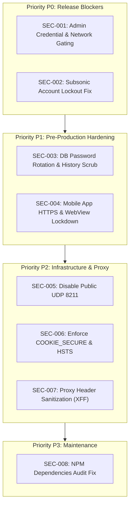

# T-Music: Security Remediation & Hardening Plan
**Target Version:** Production Release 1.0  
**Status:** Actionable Technical Guidance  
**Priority Classification:** P0 (Release Blockers) · P1 (Pre-Production) · P2 (Infrastructure & Network) · P3 (Supply Chain)

---

## 1. Remediation Priority Overview



---

## 2. Priority P0: Release Blockers

### 2.1 Remediation for SEC-001: Default Admin Password (`admin:123`)

#### Context & Constraint:
The repository contains an owner rule (2026-10-02) specifying that the admin password for local development is `123`, protected by `backend/tests/conftest.py` (`protect_admin_password`).
For a **public production deployment**, exposing an internet-accessible admin panel with `123` is unacceptable.

#### Recommended Two-Pillar Strategy:
1. **Pillar A: Network-Level Gating (Immediate / Non-Breaking)**
   In the production reverse proxy (Nginx/Traefik), restrict `/api/admin/*` and the admin login endpoint to trusted internal IP addresses, VPN, or mTLS. Public visitors can only access public routes and their own user accounts.
2. **Pillar B: Credential Rotation in Production Environment**
   In the production container deployment (separate from the local dev copy), do not use the test `music.env`. Generate a production secret:
   ```bash
   python scripts/init_admin.py
   ```
   Enter a 24+ character randomly generated passphrase. Once booted, the password is saved into the database, and `ADMIN_PASSWORD_HASH` can be removed from `music.env`.

#### Verification & Rollback:
- **Verification:** Attempt login with `admin:123` on public HTTPS endpoint; verify HTTP 401/403.
- **Rollback:** In development/staging, `python scripts/restore_admin_password.py` restores the standard developer hash.

---

### 2.2 Remediation for SEC-002: Subsonic Account Lockout DoS

#### Problem:
In [`backend/app/services/subsonic_auth.py`](file:///K:/test/tmusic/backend/app/services/subsonic_auth.py#L137), failed Subsonic authentication calls `_record_failure(db, user)`. Because `/rest/*` allows 600 req/min and lacks IP-level lockout, an unauthenticated attacker sending 5 failed requests locks the victim's web panel account for 15 minutes.

#### Solution:
Decouple Subsonic authentication failures from the primary web user account lockout. Record Subsonic failures independently (e.g., via IP rate limiter or a dedicated counter `subsonic_failed_attempts`), or apply IP lockout specifically to `/rest/*`.

#### Proposed Code Change:
In [`backend/app/services/subsonic_auth.py`](file:///K:/test/tmusic/backend/app/services/subsonic_auth.py):

```python
# Instead of mutating user.failed_login_attempts on shared account:
def _record_subsonic_failure(db: Session, client_ip: str, user: Optional[AppUser]):
    """Record failure against IP-specific rate limiter rather than locking the web account."""
    # Enforce failure counting per client IP to prevent remote DoS against legitimate users
    from app.core.rate_limiter import rate_limiter
    rate_limiter.record_failure(f"subsonic_fail_{client_ip}")
```

#### Verification:
1. Send 10 failed requests to `/rest/ping.view?u=admin&p=wrong`.
2. Confirm `/rest/ping.view` returns HTTP 200 with Subsonic error code 40 (Wrong username or password).
3. Attempt legitimate web login `POST /api/auth/login` with correct credentials.
4. Verify web login succeeds (HTTP 200) without returning `user_locked`.

---

## 3. Priority P1: Pre-Production Hardening

### 3.1 Remediation for SEC-003: Historical Database Credentials in Git

#### Procedure:
1. Connect to production PostgreSQL instance:
   ```sql
   ALTER USER postgres WITH PASSWORD '<new-randomly-generated-32-char-password>';
   ```
2. Update `.secrets/postgres_password` with the new value (permissions `0600`).
3. Update `DATABASE_URL` in `music.env`.
4. If the git repository is to be mirrored or pushed to an external forge:
   - Schedule maintenance window.
   - Use `git-filter-repo --replace-text` with a dictionary file containing the old secret string.
   - Force push cleaned branches to the remote repository.

---

### 3.2 Remediation for SEC-004: Mobile App WebView & Transport Hardening

#### Code Changes:
In [`mobile/capacitor.config.ts`](file:///K:/test/tmusic/mobile/capacitor.config.ts#L16-L19):
```typescript
server: {
  // Production setting: require HTTPS and disable arbitrary navigation
  cleartext: false,
  allowNavigation: [
    'music.yourdomain.com'
  ],
  androidScheme: 'https'
}
```

In [`mobile/android/app/src/main/AndroidManifest.xml`](file:///K:/test/tmusic/mobile/android/app/src/main/AndroidManifest.xml#L13):
```xml
<!-- Set cleartext to false for production release builds -->
<application
    android:usesCleartextTraffic="false"
    ... >
```

#### Verification:
- Build release APK: `npm run build && npx cap sync android && cd android && ./gradlew assembleRelease`.
- Verify APK rejects unencrypted `http://` endpoints.

---

## 4. Priority P2: Infrastructure & Network Hardening

### 4.1 Remediation for SEC-005: UDP LAN Discovery Port 8211 Exposure

#### Configuration Change in `docker-compose.yml`:
Remove UDP port publishing on public internet nodes:
```yaml
# docker-compose.yml
services:
  tmusic:
    ports:
      - "8005:8005"
      # REMOVE on public cloud / VPS:
      # - "8211:8211/udp"
```

In [`backend/app/core/config.py`](file:///K:/test/tmusic/backend/app/core/config.py):
Add `LAN_DISCOVERY_ENABLED: bool = False` when running in cloud production.

---

### 4.2 Remediation for SEC-006: Enforce Secure Cookies and HSTS

#### Configuration in `music.env`:
```ini
COOKIE_SECURE=true
CORS_ALLOW_LAN=false
```

#### Verification:
Send HTTPS request to `/api/auth/csrf` and `/api/auth/login`:
- Inspect `Set-Cookie`: verify `Secure`, `HttpOnly`, `SameSite=Lax`.
- Inspect response headers: verify `Strict-Transport-Security: max-age=31536000; includeSubDomains`.

---

### 4.3 Remediation for SEC-007: Reverse Proxy Configuration (Nginx)

When deploying behind Nginx, configure the proxy block to sanitize client headers:

```nginx
# /etc/nginx/conf.d/tmusic.conf
server {
    listen 443 ssl http2;
    server_name music.example.com;

    # SSL Configuration & HSTS
    ssl_certificate /etc/letsencrypt/live/music.example.com/fullchain.pem;
    ssl_certificate_key /etc/letsencrypt/live/music.example.com/privkey.pem;
    add_header Strict-Transport-Security "max-age=31536000; includeSubDomains; preload" always;

    # Restrict Admin endpoints to corporate VPN / Office IP
    location /api/admin/ {
        allow 192.168.1.0/24;
        allow 10.8.0.0/24; # VPN CIDR
        deny all;

        proxy_pass http://127.0.0.1:8005;
        proxy_set_header Host $host;
        proxy_set_header X-Real-IP $remote_addr;
        proxy_set_header X-Forwarded-For $remote_addr; # Do not append untrusted headers
        proxy_set_header X-Forwarded-Proto $scheme;
    }

    location / {
        proxy_pass http://127.0.0.1:8005;
        proxy_set_header Host $host;
        proxy_set_header X-Real-IP $remote_addr;
        proxy_set_header X-Forwarded-For $remote_addr;
        proxy_set_header X-Forwarded-Proto $scheme;
        
        # Audio streaming support
        proxy_http_version 1.1;
        proxy_buffering off;
        proxy_request_buffering off;
    }
}
```

In `music.env`:
```ini
TRUST_PROXY_HEADERS=true
```

---

## 5. Priority P3: Supply Chain & Dependencies

### 5.1 Remediation for SEC-008: Frontend Dependencies

#### Action:
Run in project root:
```bash
npm audit fix
```
Verify that `source-map-js` is updated to version `>= 1.2.1`. Run `npm run build` to confirm asset bundling completes without error.

---

## 6. Implementation Sign-Off Checklist

| Item | Description | Target Date | Assignee | Sign-off |
|---|---|---|---|---|
| P0-1 | Reverse proxy restriction for `/api/admin` configured | Pre-launch | DevOps | [ ] |
| P0-2 | Subsonic lockout decoupled from web account | Pre-launch | Backend Dev | [ ] |
| P1-1 | Postgres role password rotated on live instance | Staging | DBA | [ ] |
| P1-2 | Mobile config `cleartext: false` verified | Pre-launch | Mobile Dev | [ ] |
| P2-1 | UDP 8211 closed on edge firewall | Pre-launch | NetSec | [ ] |
| P2-2 | `COOKIE_SECURE=true` and HSTS confirmed in production env | Pre-launch | DevOps | [ ] |
| P3-1 | `npm audit fix` executed and tests verified | Maintenance | Frontend Dev | [ ] |
