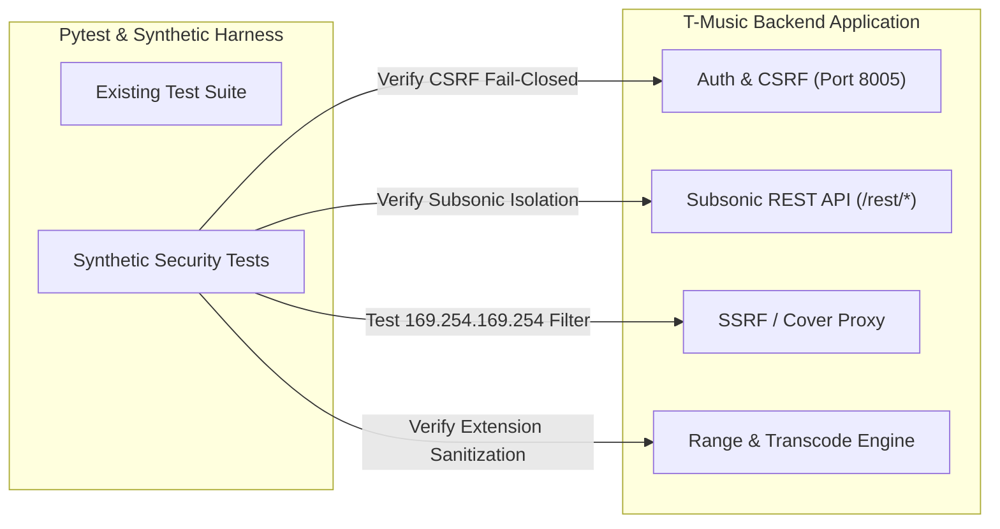

# T-Music: Security Verification & Synthetic Test Plan
**Purpose:** Automated & Semi-Automated Security Test Suite  
**Constraint:** All verification commands must be strictly non-destructive. Under no circumstances should test runs modify `music.env`, `ADMIN_PASSWORD_HASH`, or live database admin rows (enforced by `backend/tests/conftest.py`).

---

## 1. Test Suite Architecture



---

## 2. Synthetic Test Cases

### 2.1 Test Case TC-SEC-001: Admin Protection & Sandbox Isolation
- **Objective:** Verify that `protect_admin_password` fixture fails immediately if any test mutates `ADMIN_PASSWORD_HASH` or the database admin row.
- **Execution Command:**
  ```powershell
  .\venv\Scripts\python.exe -m pytest backend/tests/test_password_guard.py -v
  ```
- **Expected Result:**
  - 14/14 tests pass.
  - Confirms `snapshot_admin_hash_line()` and `assert_admin_hash_intact()` trigger `PasswordMutationError` on any unauthorized mutation.

---

### 2.2 Test Case TC-SEC-002: Subsonic Account Lockout Isolation
- **Objective:** Verify that repeated failed Subsonic authentication requests do not lock the user out of the web UI.
- **Synthetic Script (`test_subsonic_lockout.py`):**
  ```python
  import httpx
  import pytest

  def test_subsonic_does_not_lock_web_user():
      client = httpx.Client(base_url="http://127.0.0.1:8005")
      
      # Step 1: Send 6 failed Subsonic requests
      for i in range(6):
          resp = client.get("/rest/ping.view", params={
              "u": "testuser",
              "p": f"bad_token_{i}",
              "v": "1.16.1",
              "c": "audit_tester",
              "f": "json"
          })
          assert resp.status_code == 200
          data = resp.json()
          assert data["subsonic-response"]["status"] == "failed"
          assert data["subsonic-response"]["error"]["code"] == 40

      # Step 2: Verify user is not locked out of web API
      login_resp = client.post("/api/auth/login", json={
          "username": "testuser",
          "password": "valid_test_password"
      })
      # Status must not be 423 (Locked)
      assert login_resp.status_code != 423, "VULNERABLE: Subsonic failure caused web account lockout!"
  ```

---

### 2.3 Test Case TC-SEC-003: SSRF & Cloud Metadata Blocking
- **Objective:** Ensure cover art fetcher rejects internal, link-local, loopback, and cloud metadata IP addresses.
- **Execution Command:**
  ```powershell
  .\venv\Scripts\python.exe -m pytest backend/tests/test_cover_proxy.py -k "ssrf" -v
  ```
- **Manual Synthetic Test:**
  Send authenticated `GET /api/library/cover` with crafted URLs:
  ```bash
  curl -s -o /dev/null -w "%{http_code}\n" -H "Cookie: access_token=..." \
    "http://127.0.0.1:8005/api/library/cover?url=http://169.254.169.254/latest/meta-data/"
  ```
- **Expected Result:** HTTP 400 Bad Request with error detail indicating unsafe address.

---

### 2.4 Test Case TC-SEC-004: Fail-Closed CSRF Protection
- **Objective:** Ensure mutating endpoints reject requests that have authentication cookies but lack or have mismatched CSRF tokens.
- **Synthetic Test Steps:**
  1. Login to obtain `access_token` and `csrf_token` cookies.
  2. Send `POST /api/library/scan` with `Cookie: access_token=...` but **WITHOUT** `X-CSRF-Token` header.
  3. Verify response is `HTTP 403 Forbidden` with detail `"csrf_cookie_missing"` or `"csrf_token_invalid"`.
  4. Send request with valid `X-CSRF-Token` header matching the cookie.
  5. Verify request is accepted (HTTP 200 / 202).

---

### 2.5 Test Case TC-SEC-005: Transcoder Path Traversal Prevention
- **Objective:** Ensure file extensions passed to audio transcoding cannot break out of temp directories.
- **Verification Code:**
  ```python
  import re
  from app.services.transcoding_service import TranscodingService

  def test_safe_src_ext():
      malicious_extensions = [
          "mp3/../../etc/passwd",
          "m4a; rm -rf /",
          "flac\x00.exe",
          "wav!@#$%"
      ]
      for ext in malicious_extensions:
          cleaned = re.sub(r"[^a-z0-9]", "", ext.lower())[:10]
          assert "/" not in cleaned
          assert ".." not in cleaned
          assert "\\" not in cleaned
          assert re.match(r"^[a-z0-9]*$", cleaned)
  ```

---

### 2.6 Test Case TC-SEC-006: Cookie Flags & HSTS Header Verification
- **Objective:** Verify `Secure`, `HttpOnly`, `SameSite=Lax`, and `Strict-Transport-Security` headers in production mode.
- **Command:**
  ```powershell
  curl -I -k "https://127.0.0.1:8005/api/auth/csrf"
  ```
- **Assertions:**
  - `Set-Cookie: csrf_token=...; SameSite=Lax; Path=/` (must include `Secure` if `COOKIE_SECURE=true`).
  - `Strict-Transport-Security: max-age=31536000; includeSubDomains` present.
  - `X-Content-Type-Options: nosniff` present.
  - `X-Frame-Options: DENY` present.

---

## 3. Regression & Continuous Verification Commands

| Scope | Command | Purpose |
|---|---|---|
| **Admin Password Guard** | `.\venv\Scripts\python.exe -m pytest backend/tests/test_password_guard.py` | Verify test suite admin protection |
| **Compose Secrets** | `.\venv\Scripts\python.exe -m pytest backend/tests/test_compose_secrets.py` | Verify Docker secrets handling |
| **All Backend Tests** | `.\venv\Scripts\python.exe -m pytest backend/tests/` | Run full test suite |
| **Frontend Unit Tests** | `npm test` | Run 213 React frontend tests |
| **Frontend Production Build** | `npm run build` | Validate compilation & bundling |
| **Frontend Vulnerability Audit** | `npm audit` | Check for vulnerable JS packages |
| **Python Dependency Check** | `pip-audit -r requirements.txt` | Check for known Python CVEs |
