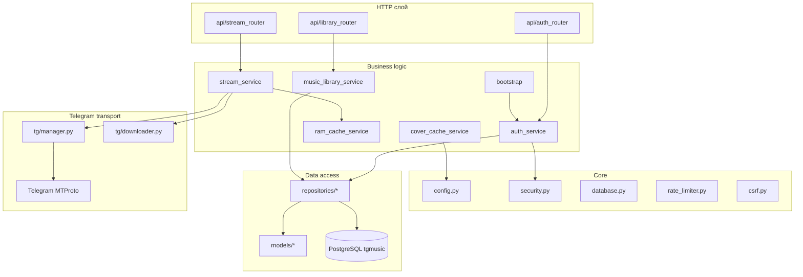
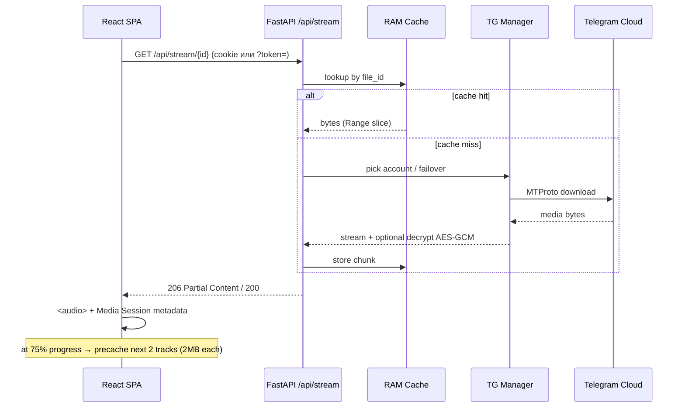
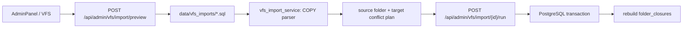

# Архитектура

#tmusic #архитектура

Принцип: **чистая слоистая архитектура без God Objects**. HTTP-роутеры тонкие, бизнес-логика в services, доступ к данным — repositories, транспорт Telegram изолирован в `app/tg/`.

См. также: [[ADR-001 No God Objects]]

---

## Слои backend

---

## Поток стриминга трека

---

## Каталог vs VFS

| Слой | Таблицы | Роль |
|------|---------|------|
| VFS | `folders`, `vfiles`, `folder_closures` | Файловое дерево (треки = `vfiles`) |
| Каталог | `music_artists`, `music_albums` | Витрина: артисты, альбомы, обложки |
| Связь | `folder_id` (FK) | Артист/альбом привязан к папке VFS |

Recursive-обход альбома (multi-disc) — через `folder_closures`.

---

## Импорт VFS из Replit SQL backup

SQL dump не исполняется. Разрешены только `folders`, `folder_closures` и `vfiles`; credentials, DDL, playlists и shares игнорируются. Импортируются VFS metadata и Telegram locators, а не аудиобайты.

Подробнее: [[Импорт VFS из SQL]].

---

## Маршрут SPA

Catch-all `GET /{full_path:path}` → отдача файлов из `frontend/dist` **только** после `resolve()` + `is_relative_to(FRONTEND_DIST)`, иначе SPA-shell `index.html`.

Подробнее: [[Аудит 2026-09]] · [[Архитектура безопасности]]

---

## Связанные заметки

- [[Модели БД]]
- [[Telegram кластер]]
- [[Кэш и стриминг]]
- [[Карта репозитория]]
- [[00-Главная]]
