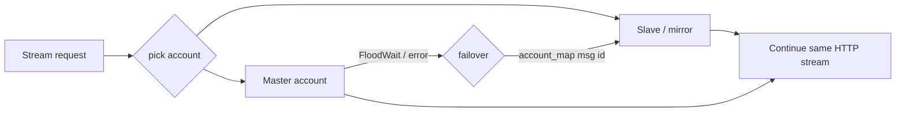

# Telegram кластер

#tmusic #backend #telegram

Модуль: `backend/app/tg/manager.py` (+ `downloader.py`)  
Модель: [[Модели БД]] → `TGAccount`

---

## Назначение

- Параллельный старт нескольких MTProto-клиентов Pyrogram
- **In-memory** sessions (`in_memory=True`) — без файловых SQLite-локов
- Tracking `FloodWait` по аккаунтам
- **Mid-stream failover**: поток переключается на зеркало без обрыва звука
- Self-heal: plaintext `session_string` / `api_hash` → Fernet при старте

---

## Шифрование at-rest

```
Fernet key = urlsafe_b64(sha256(SESSION_SECRET.encode()))
```

| Функция | Роль |
|---------|------|
| `encrypt_session_string` | Fernet.encrypt |
| `is_encrypted` | Валидный Fernet-token? |
| `decrypt_session_string` | decrypt; при ошибке возврат как есть + warn |
| `ensure_encrypted` | encrypt if not already |
| `seal_tg_account` | Мутация полей аккаунта in-place (0..2 sealed) |

Единая точка инварианта «encrypt if not encrypted»: runtime, CLI, миграция.

См. [[ADR-002 Fernet TG Sessions]] · [[Операционные скрипты]]

---

## Поток failover



`VFile.account_map` (JSON) хранит соответствие message/file id по аккаунтам — это позволяет продолжить поток с зеркала.

---

## Конфигурация (`music.env`)

| Переменная | Назначение |
|------------|------------|
| `TG_API_ID` | Telegram API id |
| `TG_API_HASH` | Ключ (в БД может быть Fernet) |
| `TG_SESSION_STRING` | Legacy bootstrap-сессия |
| `TG_SESSION_NAME` | default `tmusic_session` |
| `TG_WORKERS` | default 2 |
| `SLEEP_THRESHOLD` | default 60 |
| `SESSION_SECRET` | Ключ шифрования TG-ключей в БД |
| `TG_MAX_CONCURRENT_TRANSMISSIONS` | default 3 |

---

## Операции

| Операция | Команда / место |
|----------|-----------------|
| Создать новую сессию | `python scripts/create_session.py` |
| Миграция из CloudByte | `python scripts/migrate_data.py` |
| Аудит / перешифровка | `python scripts/secure_tg_accounts.py` (`--check`) |
| Runtime self-heal | `tg_manager.start()` |

**Ротация `SESSION_SECRET`** = потеря возможности расшифровать сессии → перевыпуск через `create_session.py`.

---

## Деградация

`tg_manager.start()` в try/except: при недоступной БД/сессиях SPA работает, стриминг падает gracefully.

---

## Связанные заметки

- [[API Stream]]
- [[Кэш и стриминг]]
- [[Архитектура безопасности]]
- [[music.env]]

[[00-Главная]]
