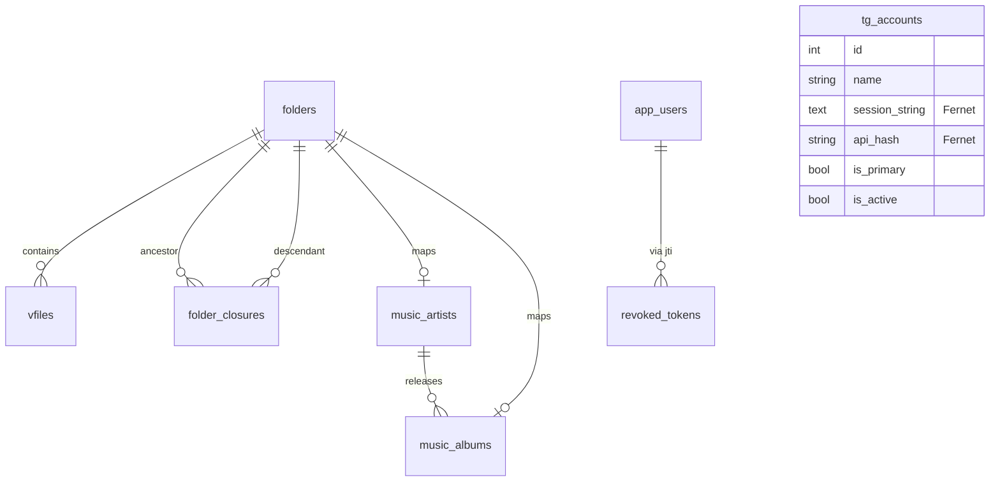

# Модели БД

#tmusic #backend #database

База: **PostgreSQL** `tgmusic`. ORM: SQLAlchemy 2.0. Экспорт: `backend/app/models/__init__.py`.

---

## ER-диаграмма (логическая)

---

## VFS (`vfs.py`)

### TGAccount — `tg_accounts`
| Поле | Тип | Назначение |
|------|-----|------------|
| id | int PK | |
| name | str | Человекочитаемое имя аккаунта |
| api_id | str? | Telegram API id |
| api_hash | str? | **Fernet-шифрованный** api_hash |
| session_string | text? | **Fernet-шифрованная** MTProto-сессия |
| is_active / is_primary | bool | Участие в кластере / master |
| status | str | `active` по умолчанию |
| last_used / created_at | datetime | |

См. [[Telegram кластер]] · [[ADR-002 Fernet TG Sessions]]

### Folder — `folders`
| Поле | Тип | Назначение |
|------|-----|------------|
| id | int PK | |
| name | str | |
| parent_id | FK folders.id? | Родитель |
| is_trash / is_starred | bool | Корзина / избранное |
| color / note / custom_icon | str? | UI-метаданные |
| cached_total_size / cached_file_count | int | Денормализация |

Индекс: `idx_folders_parent_trash (parent_id, is_trash)`

### FolderClosure — `folder_closures`
| Поле | Тип | Назначение |
|------|-----|------------|
| ancestor_id | FK folders | PK |
| descendant_id | FK folders | PK |
| depth | int | Глубина |

Индексы по ancestor и descendant. Используется recursive-списком треков multi-disc альбома.

### VFile — `vfiles`
| Поле | Тип | Назначение |
|------|-----|------------|
| id | int PK | file_id для `/api/stream/{id}` |
| name | str | Имя трека/файла |
| size | int? | Байты (для encrypted — plaintext size из stream_service) |
| mime_type | str? | audio/* |
| tg_message_id / msg_ids / tg_file_id | | Маппинг в Telegram |
| folder_id | FK folders | Контейнер |
| is_starred / is_trash / pending_deletion | bool | Флаги |
| encryption_salt / encryption_header / is_encrypted | | AES-GCM vault |
| note / custom_icon | | UI |
| account_map | JSON | Маппинг message-id по аккаунтам кластера (failover) |

Индексы: folder+trash, mime, trash+mime.

---

## Каталог (`music.py`)

### MusicArtist — `music_artists`
| Поле | Тип | Назначение |
|------|-----|------------|
| id | int PK | |
| folder_id | FK folders **unique** | Папка-исполнитель в VFS |
| kind | str | `artist` \| `compilation` \| `standalone_album` \| `genre_collection` |
| display_name / search_name | str | UI + поиск |
| mbid / image_url / bio / wikipedia_url | | Enrichment (Last.fm/Discogs/MusicBrainz — опц.) |
| confidence / locked / custom_image_key / enriched_at | | Качество метаданных |

### MusicAlbum — `music_albums`
| Поле | Тип | Назначение |
|------|-----|------------|
| id | int PK | |
| folder_id | FK folders **unique** | Папка-альбом |
| artist_id | FK music_artists CASCADE | |
| title / year / mbid / cover_url | | |
| confidence / custom_image_key / enriched_at | | |

---

## Auth (`auth.py`)

### AppUser — `app_users`
| Поле | Тип | Назначение |
|------|-----|------------|
| username | unique | |
| password_hash | bcrypt (255) | SHA-256 без соли **отклоняется** |
| is_active | bool | |
| failed_login_attempts | int | Brute-force |
| locked_until | datetime? | Account lockout |
| **token_version** | int | Инкремент при смене пароля → старые JWT невалидны |

### RevokedToken — `revoked_tokens`
| Поле | Тип | Назначение |
|------|-----|------------|
| jti | unique | ID токена |
| expires_at | datetime | Для purge на старте |
| created_at | datetime | |

---

## Индексы производительности

При старте: `ensure_performance_indexes()`, `ensure_auth_schema()`, `ensure_trigram_indexes()` (поиск артистов/альбомов).

---

## Связанные заметки

- [[Обзор Backend]]
- [[API Library]]
- [[API Stream]]
- [[Архитектура]]

[[00-Главная]]
